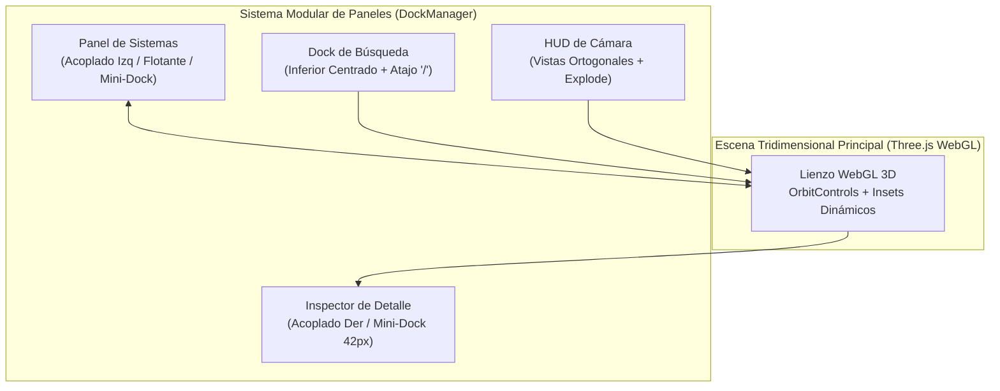
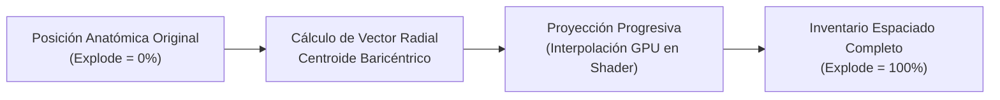
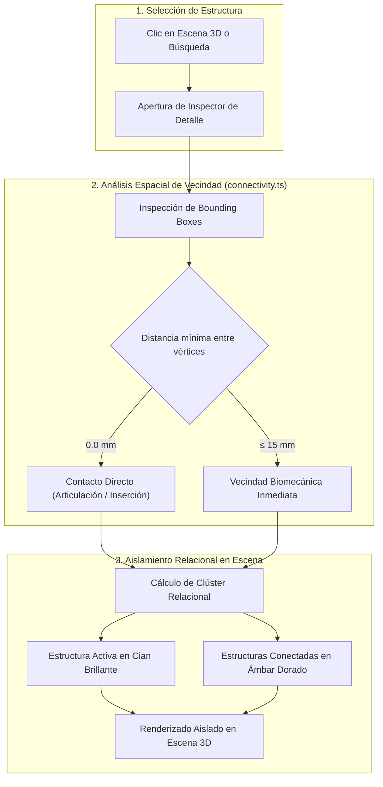

# ANATOMIA HUMANA EN 3D

> **Codex Anatómico 2026** : Explorador Tridimensional del Cuerpo Humano Basado en BodyParts3D 4.0 con 2.234 Meshes Individuales, 15 Sistemas Anatómicos, Motor de Conectividad y Proximidad Forense en mm, Interfaz Modular Acoplable con Mini-Docks y Soberanía Local sin Dependencias Externas.

<div align="center">

[](https://lifesciencedb.jp/bp3d/)
[](https://threejs.org)
[](https://react.dev)
[](https://www.typescriptlang.org)
[](https://github.com)
[](public/ATTRIBUTION.md)

</div>

---

## 🎬 Demostración Oficial de la Aplicación (Product Tour en Vídeo)

https://github.com/user-attachments/assets/2a493543-67e7-4775-915a-e86f6b04c05a

*Recorrido fidedigno del sistema en 1080p Full HD en Modo Oscuro nativo con puntero focal de alta visibilidad y pulsos de interacción: Nuevos preajustes de capas (Esqueleto, Musculatura, Órganos, Circulatorio, Nervioso, Todos), controles de visibilidad "Ver y No Ver" (Ocultar/Mostrar todo y switches independientes), despiece espacial tridimensional (Explode view), buscador predictivo con miniaturas 3D en tiempo real, motor de análisis de proximidad y conectividad anatómica con aislamiento relacional.*

🔊 **[Descargar Vídeo Maestro de Demostración (1080p MP4 · 8.24 MB)](https://github.com/user-attachments/assets/2a493543-67e7-4775-915a-e86f6b04c05a)**


---

---

## 🏛️ Prólogo: Principios Fundacionales del Sistema

Atlas Humano 3D nace de la necesidad de proporcionar una herramienta de exploración anatómica de fidelidad científica sin precedentes, capaz de ejecutarse con fluidez directamente en cualquier navegador web moderno sin requerir servidores externos, telemetría propietaria ni descargas desmedidas de datos.

La plataforma se asienta sobre cuatro pilares arquitectónicos innegociables:

1. **Rigor Anatómico y Fidelidad Topológica**: Basado íntegramente en el modelo de referencia masculino adulto **BodyParts3D 4.0** del *Database Center for Life Science (DBCLS)* de Japón. Se preservan **2.234 meshes independientes**, agrupadas en **3.432 conceptos anatómicos normalizados** bajo la nomenclatura internacional FMA (Foundational Model of Anatomy).
2. **Soberanía y Ejecución 100% Local (Zero-Cloud Policy)**: Todo el catálogo geométrico (33 MB comprimidos) y el índice terminológico residen en el cliente. No se realizan llamadas a servicios cloud de telemetría ni APIs externas durante la exploración; los datos médicos y la actividad del usuario permanecen exclusivamente en su equipo.
3. **Alto Rendimiento Gráfico mediante GPU Batching**: A diferencia de los visores 3D tradicionales que saturan la CPU con miles de llamadas de dibujado (*draw calls*), este atlas unifica las piezas en lotes de mallas estáticas y controla la traslación, visibilidad y selección mediante texturas de estado cargadas directamente en memoria de vídeo (VRAM).
4. **Inspección Relacional y Análisis Biomecánico de Contacto**: Ningún órgano o hueso existe aislado. El sistema integra un motor de conectividad espacial que calcula en tiempo real la distancia euclídea mínima en milímetros entre la pieza activa y sus vecinos, detectando superficies en contacto directo (0 mm) e inserciones vasculares o musculares inmediatas.

---

# 📚 Índice General de la Obra

- [🏛️ Prólogo: Principios Fundacionales del Sistema](#️-prólogo-principios-fundacionales-del-sistema)
- [PARTE I: ESPACIO DE TRABAJO 3D E INTERFAZ MODULAR ACOPLABLE](#parte-i-espacio-de-trabajo-3d-e-interfaz-modular-acoplable)
  - [Capítulo 1: Arquitectura del Gestor de Paneles (DockManager)](#capítulo-1-arquitectura-del-gestor-de-paneles-dockmanager)
  - [Capítulo 2: Zonas de Anclaje (Snap Zones), Desacople Flotante y Mini-Docks de 42px](#capítulo-2-zonas-de-anclaje-snap-zones-desacople-flotante-y-mini-docks-de-42px)
  - [Capítulo 3: Alternancia de Tema Claro / Oscuro y Localización Bilingüe (ES / EN)](#capítulo-3-alternancia-de-tema-claro--oscuro-y-localización-bilingüe-es--en)
- [PARTE II: GESTIÓN DE CAPAS Y PREAJUSTES DE SISTEMAS ANATÓMICOS](#parte-ii-gestión-de-capas-y-preajustes-de-sistemas-anatómicos)
  - [Capítulo 4: El Catálogo de los 15 Sistemas Anatómicos](#capítulo-4-el-catálogo-de-los-15-sistemas-anatómicos)
  - [Capítulo 5: Nuevos Preajustes de Acceso Rápido (Esqueleto, Músculos, Órganos, Circulatorio, Nervioso)](#capítulo-5-nuevos-preajustes-de-acceso-rápido-esqueleto-músculos-órganos-circulatorio-nervioso)
  - [Capítulo 6: Controles de Visibilidad Forense ("Ver y No Ver": Ocultar Todo, Mostrar Todo y Switches)](#capítulo-6-controles-de-visibilidad-forense-ver-y-no-ver-ocultar-todo-mostrar-todo-y-switches)
  - [Capítulo 7: Reorganización Dinámica de Capas (Drag and Drop con Persistencia)](#capítulo-7-reorganización-dinámica-de-capas-drag-and-drop-con-persistencia)
- [PARTE III: VISUALIZACIÓN ESPACIAL, CONTROL DE CÁMARA Y DESPIECE 3D](#parte-iii-visualización-espacial-control-de-cámara-y-despiece-3d)
  - [Capítulo 8: Cinemática de Cámara (OrbitControls, Presets Ortogonales y Auto-Rotación)](#capítulo-8-cinemática-de-cámara-orbitcontrols-presets-ortogonales-y-auto-rotación)
  - [Capítulo 9: Motor de Despiece Progresivo (Explode Slider y Empaquetamiento Tridimensional)](#capítulo-9-motor-de-despiece-progresivo-explode-slider-y-empaquetamiento-tridimensional)
  - [Capítulo 10: Insets de Escena Dinámicos y Prevención de Oclusiones](#capítulo-10-insets-de-escena-dinámicos-y-prevención-de-oclusiones)
- [PARTE IV: BÚSQUEDA PREDICTIVA, DICCIONARIO MÉDICO Y MINIATURAS 3D](#parte-iv-búsqueda-predictiva-diccionario-médico-y-miniaturas-3d)
  - [Capítulo 11: Dock Inferior de Búsqueda y Atajo Universal de Teclado ("/")](#capítulo-11-dock-inferior-de-búsqueda-y-atajo-universal-de-teclado-)
  - [Capítulo 12: Indexación de Sinónimos y Cruce Terminológico FMA / UMLS](#capítulo-12-indexación-de-sinónimos-y-cruce-terminológico-fma--umls)
  - [Capítulo 13: Miniaturas 3D Reactivas Generadas al Vuelo (PieceThumbnail)](#capítulo-13-miniaturas-3d-reactivas-generadas-al-vuelo-piecethumbnail)
- [PARTE V: INSPECTOR DETALLADO Y MOTOR DE CONECTIVIDAD ANATÓMICA](#parte-v-inspector-detallado-y-motor-de-conectividad-anatómica)
  - [Capítulo 14: Ficha Biomecánica (Métricas, Geometría, Coordenadas y Volumen)](#capítulo-14-ficha-biomecánica-métricas-geometría-coordenadas-y-volumen)
  - [Capítulo 15: Algoritmo de Proximidad Física y Distancia Euclídea en Milímetros (0 mm Contacto)](#capítulo-15-algoritmo-de-proximidad-física-y-distancia-euclídea-en-milímetros-0-mm-contacto)
  - [Capítulo 16: Aislamiento Relacional 3D (Resaltado Dual Cyan + Ámbar y Clicks de Visibilidad 3D)](#capítulo-16-aislamiento-relacional-3d-resaltado-dual-cyan--ámbar-y-clicks-de-visibilidad-3d)
- [PARTE VI: ARQUITECTURA TÉCNICA Y OPTIMIZACIÓN WEBGL](#parte-vi-arquitectura-técnica-y-optimización-webgl)
  - [Capítulo 17: Pipeline de Geometría y GPU Batching](#capítulo-17-pipeline-de-geometría-y-gpu-batching)
  - [Capítulo 18: Texturas de Estado en GPU (Visibilidad, Transformación y Selección)](#capítulo-18-texturas-de-estado-en-gpu-visibilidad-transformación-y-selección)
  - [Capítulo 19: Render On-Demand y Ciclo de Vida Libre de Fugas de Memoria](#capítulo-19-render-on-demand-y-ciclo-de-vida-libre-de-fugas-de-memoria)
- [PARTE VII: COMANDOS DE CONSOLA Y GUÍA DE OPERACIÓN LOCAL](#parte-vii-comandos-de-consola-y-guía-de-operación-local)
  - [Capítulo 20: Arranque en Desarrollo y Compilación Estática](#capítulo-20-arranque-en-desarrollo-y-compilación-estática)
  - [Capítulo 21: Batería de Pruebas de Integridad e Interacción](#capítulo-21-batería-de-pruebas-de-integridad-e-interacción)
  - [Capítulo 22: Reconstrucción y Optimización Opcional de Geometría](#capítulo-22-reconstrucción-y-optimización-opcional-de-geometría)

---

## PARTE I: ESPACIO DE TRABAJO 3D E INTERFAZ MODULAR ACOPLABLE



### Capítulo 1: Arquitectura del Gestor de Paneles (DockManager)

El entorno de trabajo no recurre a ventanas emergentes rígidas ni a diálogos modales que bloqueen la interacción con la escena. En su lugar, el módulo `app/dock-manager.ts` gestiona un grafo de estados desacoplado para cada panel:

- **Modos de Ubicación**: Cada tarjeta informativa puede existir en estado acoplado a la izquierda (`docked-left`), acoplado a la derecha (`docked-right`), libremente flotante (`floating`) o colapsado en el borde (`minimized`).
- **Control de Profundidad (Z-Index Dinámico)**: Al interactuar o hacer clic en cualquier panel, la función `bringToFront` eleva su prioridad visual sin interferir en los eventos de puntero del lienzo Three.js.
- **Redimensionamiento Reactivo**: Los paneles admiten redimensionamiento manual arrastrando sus bordes, recalculando dinámicamente el área útil de la cámara 3D.

### Capítulo 2: Zonas de Anclaje (Snap Zones), Desacople Flotante y Mini-Docks de 42px

Al arrastrar un panel por su cabecera:

1. **Detección de Proximidad**: Si el puntero se acerca a menos de 48 píxeles del borde izquierdo o derecho de la ventana, se activa una baliza translúcida (`activeSnapZone`).
2. **Fijación Automática (Snap)**: Al soltar el puntero sobre la zona activa, el panel se ancla al borde seleccionado a 0 píxeles de holgura.
3. **Mini-Dock Colapsable de 42px**: Al pulsar el botón de minimizar (`-`), el panel se repliega en una tira vertical estilizada de 42 píxeles de anchura fijada contra el lateral de la pantalla. Este mini-dock conserva el título de la estructura activa y un contador de elementos, permitiendo restaurar la vista completa con un único clic.

### Capítulo 3: Alternancia de Tema Claro / Oscuro y Localización Bilingüe (ES / EN)

- **Selector de Tema (Dark / Light Mode)**:
  - Modo Claro: Diseñado para entornos clínicos y de estudio, con fondo blanco perlado, sombras gaussianas suaves y contraste nítido en tipografía oscura.
  - Modo Oscuro: Paleta de tonos pizarra profunda (`#090d16` a `#151c2e`), fondos de vidrio escarchado (*frosted glass*) con desenfoque de 20 píxeles y realce luminiscente en los elementos seleccionados.
  - La preferencia se persiste en el almacenamiento de sesión (`sessionStorage`) para mantener la coherencia durante toda la navegación.
- **Internacionalización Integral (i18n)**:
  - Cambio en caliente entre español e inglés mediante el selector superior.
  - El módulo `app/i18n.ts` y las tablas de traducción `app/anatomy-translation.ts` traducen no solo los controles de la interfaz, sino los 3.432 nombres de conceptos anatómicos, sus descripciones médicas y los nombres de las 2.234 piezas geométricas individuales.

---

## PARTE II: GESTIÓN DE CAPAS Y PREAJUSTES DE SISTEMAS ANATÓMICOS

### Capítulo 4: El Catálogo de los 15 Sistemas Anatómicos

El cuerpo humano se estructura en 15 subsistemas funcionales independientes, cada uno identificado con un color distintivo y un recuento exacto de mallas modeladas:

| Icono | Sistema Anatómico | ID del Sistema | Color Identificador | Recuento de Mallas |
|:---:|---|---|:---:|:---:|
| 🦴 | **Sistema Esquelético** | `skeletal` | `#c4b78a` | 296 piezas |
| 🏋️ | **Sistema Muscular** | `muscular` | `#a85b50` | 402 piezas |
| ❤️ | **Sistema Cardíaco** | `cardiac` | `#e05353` | 23 piezas |
| 👁️ | **Órganos Sensoriales** | `sensory` | `#53a39e` | 45 piezas |
| 🩸 | **Sistema Arterial** | `arterial` | `#c94747` | 639 piezas |
| 💧 | **Sistema Venoso** | `venous` | `#3b779e` | 404 piezas |
| 🧠 | **Sistema Nervioso** | `nervous` | `#d4a34b` | 139 piezas |
| 🫁 | **Sistema Respiratorio** | `respiratory` | `#639aa0` | 119 piezas |
| 🥗 | **Sistema Digestivo** | `digestive` | `#a68352` | 97 piezas |
| 🧪 | **Sistema Urinario** | `urinary` | `#8570a3` | 6 piezas |
| 🛡️ | **Sistema Linfático** | `lymphatic` | `#589e6e` | 3 piezas |
| ⚡ | **Sistema Endocrino** | `endocrine` | `#b8678d` | 4 piezas |
| 🧬 | **Sistema Reproductor** | `reproductive` | `#9c6579` | 12 piezas |
| 🛡️ | **Superficie Corporal** | `integumentary` | `#c29b82` | 5 piezas |
| 🌐 | **Tejido Conectivo** | `connective` | `#7a8f99` | 40 piezas |

### Capítulo 5: Nuevos Preajustes de Acceso Rápido (Esqueleto, Músculos, Órganos, Circulatorio, Nervioso)

En la parte superior del panel de capas se ubica la barra de **Preajustes de Acceso Rápido**, provista de iconos específicos y activación con un solo toque:

1. **Todos (`presetAll`)**: Restaura instantáneamente los 15 sistemas anatómicos en pantalla (2.234 piezas).
2. **Esqueleto (`presetSkeleton`)**: Aísla la totalidad de los huesos y cartílagos articulares (296 piezas), retirando tejidos blandos para análisis óseo puro.
3. **Músculos (`presetMuscles`)**: Enfoca la musculatura estriada superficial y profunda (402 piezas).
4. **Órganos (`presetOrgans`)**: Presenta en conjunto los sistemas cardíaco, respiratorio, digestivo, urinario, endocrino y reproductor, eliminando la caja torácica y la pared muscular para estudiar las vísceras.
5. **Circulatorio (`presetCirculatory`)**: Sincroniza el corazón, el árbol arterial y el retorno venoso (1.066 piezas vasculares).
6. **Nervioso (`presetNervous`)**: Despliega el encéfalo, médula espinal, pares craneales, nervios periféricos y órganos de los sentidos (184 piezas).

### Capítulo 6: Controles de Visibilidad Forense ("Ver y No Ver": Ocultar Todo, Mostrar Todo y Switches)

El pie del panel de sistemas integra los mandos de visibilidad masiva y control selectivo:

- **Botón "Ocultar todo" (`EyeOff`)**: Apaga de forma inmediata la visibilidad de todas las mallas, dejando el lienzo en blanco para construir reconstrucciones anatómicas desde cero.
- **Botón "Mostrar todo" (`Eye`)**: Reactiva todos los sistemas desactivados previamente.
- **Conmutadores Independientes (`Switch`)**: Cada una de las 15 filas dispone de un switch coloreado según el tono del sistema para encender o apagar ese estrato de manera aislada.
- **Aislamiento por Nombre**: Al pulsar sobre el nombre o icono de cualquier sistema, se ocultan todos los demás y se muestra exclusivamente dicho sistema.

### Capítulo 7: Reorganización Dinámica de Capas (Drag and Drop con Persistencia)

- El usuario puede reordenar la jerarquía de los sistemas arrastrando las filas desde su manija izquierda (`GripVertical`).
- Los indicadores visuales marcan con precisión la línea de inserción superior o inferior.
- El orden personalizado se guarda en `sessionStorage` (`anatomy_systems_order`), de modo que la secuencia preferida por el usuario se conserva durante toda su sesión de trabajo.

---

## PARTE III: VISUALIZACIÓN ESPACIAL, CONTROL DE CÁMARA Y DESPIECE 3D

### Capítulo 8: Cinemática de Cámara (OrbitControls, Presets Ortogonales y Auto-Rotación)

El control de cámara sobre la escena 3D se opera a través del HUD flotante ubicado en el margen derecho:

- **Rotación Libre e Inercia**: Arrastre con el botón principal del ratón (o toque táctil simple) para orbitar con amortiguación inercial continua.
- **Desplazamiento Lateral (Pan)**: Arrastre con el botón secundario del ratón (o dos dedos en pantallas táctiles).
- **Vistas Predefinidas Instantáneas**:
  - `3/4 3D`: Perspectiva axonométrica canónica tres cuartos.
  - `F (Frente)`: Vista ortogonal coronal anterior.
  - `L (Lado)`: Vista sagital lateral izquierda.
  - `P (Atrás)`: Vista coronal posterior.
- **Auto-Rotación Cinematográfica**: El botón con icono de reproducción activa el giro continuo suave del modelo a 1.2 revoluciones por minuto para demostraciones y exposiciones docentes.

### Capítulo 9: Motor de Despiece Progresivo (Explode Slider y Empaquetamiento Tridimensional)

El deslizador vertical de **Desplazamiento / Explode** (`0%` a `100%`) activa un algoritmo cinemático que proyecta cada pieza anatómica visible hacia el exterior:



- **Sin Solapamientos**: El algoritmo `app/explosion-layout.ts` calcula celdas de volumen no intersectantes según la relación de aspecto del visor.
- **Interpolación en GPU**: El desplazamiento no recalcula las coordenadas geométricas en CPU; una textura de traslación en la GPU interpola vectorialmente la posición entre el estado ensamblado y el estado de despiece en cada cuadro de renderizado a 60 FPS.

### Capítulo 10: Insets de Escena Dinámicos y Prevención de Oclusiones

Cuando el inspector de detalle o el panel de capas se abren o se acoplan en los laterales de la pantalla, el método `computeSceneInsets` calcula los márgenes libres y reubica el punto focal de la cámara Three.js. Esto garantiza que el centro geométrico del cuerpo humano permanezca siempre en el espacio visible no tapado por los paneles.

---

## PARTE IV: BÚSQUEDA PREDICTIVA, DICCIONARIO MÉDICO Y MINIATURAS 3D

### Capítulo 11: Dock Inferior de Búsqueda y Atajo Universal de Teclado ("/")

El acceso a los 3.432 conceptos anatómicos se realiza a través de la barra de búsqueda anclada en la base de la pantalla:

- **Atajo Global de Teclado**: Pulsar la tecla `/` en cualquier momento enfoca el campo de texto y despliega la consola predictiva sin requerir clics previos.
- **Pulsación de Escape**: Cierra el panel de resultados y devuelve el foco al lienzo 3D.
- **Cierre por Clic Externo**: Si el usuario pulsa en el fondo del visor, la ventana emergente de resultados se repliega automáticamente para despejar la vista.

### Capítulo 12: Indexación de Sinónimos y Cruce Terminológico FMA / UMLS

El módulo `app/synonyms.ts` incorpora una matriz de búsqueda fonética y semántica que resuelve consultas coloquiales y términos clínicos:

| Término Buscado | Coincidencia Canónica Resuelta | Sistema Asociado | Código FMA |
|---|---|---|---|
| *cerebro* | Encéfalo | Nervioso | `FMA50801` |
| *corazón* | Corazón | Cardíaco | `FMA7088` |
| *femur* | Fémur | Esquelético | `FMA9611` |
| *pulmón* | Pulmón derecho / Pulmón izquierdo | Respiratorio | `FMA7310` |
| *estómago* | Estómago | Digestivo | `FMA7148` |
| *bazo* | Bazo | Linfático | `FMA15844` |
| *aorta* | Aorta torácica / Aorta abdominal | Arterial | `FMA3734` |

### Capítulo 13: Miniaturas 3D Reactivas Generadas al Vuelo (PieceThumbnail)

Cada elemento de la lista de resultados no se conforma con mostrar texto plano:

- **Renderizado Offscreen Asíncrono**: El servicio `app/thumbnail-service.ts` extrae los vértices de la malla solicitada y los renderiza en un contexto WebGL en segundo plano con iluminación de estudio y fondo transparente.
- **Caché en Memoria**: Las imágenes generadas se conservan en un mapa de memoria volátil (`Map<string, string>`), garantizando que la segunda consulta de un órgano se muestre de forma instantánea sin carga de CPU.

---

## PARTE V: INSPECTOR DETALLADO Y MOTOR DE CONECTIVIDAD ANATÓMICA



### Capítulo 14: Ficha Biomecánica (Métricas, Geometría, Coordenadas y Volumen)

Al seleccionar cualquier componente del cuerpo humano, el inspector lateral despliega:

- **Miniatura Tridimensional Rotatoria**: Una vista orbital miniatura interactiva del componente aislado.
- **Identificadores Oficiales**: Código de la ontología FMA y número de mallas asociadas.
- **Descripción Médica Exhaustiva**: Definición funcional y anatómica en castellano e inglés.
- **Dimensiones Reales**: Anchura, altura y profundidad en milímetros derivadas de la bounding box real del donante anatómico.

### Capítulo 15: Algoritmo de Proximidad Física y Distancia Euclídea en Milímetros (0 mm Contacto)

El algoritmo implementado en `app/connectivity.ts` ejecuta un análisis de proximidad geométrica entre piezas:

$$\text{Distancia}(A, B) = \min_{p_a \in A, p_b \in B} \| p_a - p_b \|$$

- **Contacto Directo (0 mm)**: Identifica superficies que comparten plano articular, inserciones tendinosas directas o paso de conductos viscerales.
- **Porcentaje de Cercanía Relativa**: Normaliza la distancia en una escala porcentual del 0% al 100%, indicando al usuario la relevancia funcional del contacto.
- **Filtro por Categoría Biomecánica**: Permite filtrar las conexiones por tipo (Huesos, Músculos, Órganos, Vasos, Nervios).

### Capítulo 16: Aislamiento Relacional 3D (Resaltado Dual Cyan + Ámbar y Clicks de Visibilidad 3D)

La gran innovación del visor radica en el botón interactivo **3D** asociado a cada elemento de la lista de conexiones:

- **Conmutador 3D Individual con Icono Eye / EyeOff**: Al hacer clic en el botón 3D de una estructura vecina, el sistema oculta todo el resto del cuerpo y muestra **únicamente la pieza activa junto con las estructuras conectadas elegidas**.
- **Código Cromático de Doble Realce**:
  - **Cian Eléctrico (`#22d3ee`)**: La estructura seleccionada por el usuario (ej. Fémur o Corazón).
  - **Ámbar Dorado (`#f59e0b`)**: Las piezas anatómicas conectadas activadas (ej. Arteria Femoral, Vena Cava, Músculos Aductores).
- **Aislamiento Total del Clúster**: El botón `Aislar estructura` suprime todo el entorno anatómico no relacionado, permitiendo una disección visual quirúrgica sin interferencia del resto de órganos.

---

## PARTE VI: ARQUITECTURA TÉCNICA Y OPTIMIZACIÓN WEBGL

### Capítulo 17: Pipeline de Geometría y GPU Batching

Para mantener 60 FPS estables en equipos portátiles y dispositivos con gráficas integradas:

- Las 2.234 mallas no se crean como objetos `THREE.Mesh` individuales.
- Se compilan en mallas combinadas por lotes (*batched meshes*) organizadas por material y transparencia.
- El modelo completo suma **2.288.268 triángulos** optimizados con un límite de error relativo inferior al 0.2% por estructura.

### Capítulo 18: Texturas de Estado en GPU (Visibilidad, Transformación y Selección)

- El estado de cada pieza se codifica en texturas de datos GPU (*DataTexture*):
  - Textura de Visibilidad: 1 bit por pieza indicando si el fragment shader debe descartar el píxel.
  - Textura de Color y Realce: Valores RGB de selección (Cian, Ámbar o color natural del sistema).
  - Textura de Desplazamiento: Vectores 3D de traslación para el modo despiece.
- La CPU solo envía pequeñas actualizaciones de textura cuando cambia el estado, eliminando el coste de iterar sobre matrices de transformación en cada frame.

### Capítulo 19: Render On-Demand y Ciclo de Vida Libre de Fugas de Memoria

- **Renderizado Reactivo On-Demand**: Cuando el usuario no está interactuando con la escena y el modo de auto-rotación está pausado, el bucle `requestAnimationFrame` se detiene por completo, reduciendo el consumo de batería y la temperatura de la GPU a cero.
- **Liberación Estricta de Recursos WebGL**: Todos los buffers, geometrías, materiales y texturas creados durante las búsquedas o inspecciones se destruyen formalmente mediante `dispose()` al desmontar componentes o reiniciar la escena.

---

## PARTE VII: COMANDOS DE CONSOLA Y GUÍA DE OPERACIÓN LOCAL

### Capítulo 20: Arranque en Desarrollo y Compilación Estática

Requisitos del entorno: **Node.js 22.13** o superior y gestor de paquetes npm. No se requieren claves de API ni configuración de bases de datos externas.

```sh
# 1. Instalación de dependencias congeladas
npm ci

# 2. Iniciar servidor de desarrollo local
npm run dev

# 3. Compilación estática optimizada para producción
npm run build
```

El servidor local se iniciará en `http://localhost:3016`. La compilación estática exporta los activos listos para desplegar en cualquier servidor HTTP o CDN dentro del directorio `dist/`.

### Capítulo 21: Batería de Pruebas de Integridad e Interacción

El repositorio incluye un conjunto de pruebas automatizadas que verifican la integridad geométrica y los contratos de interacción:

```sh
# Verificación de tipos TypeScript y formato
npm run check

# Validación de atlas geométrico, nombres y pertenencia a sistemas
node scripts/validate-atlas.mjs

# Validación de contratos de interacción, despiece sin colisiones y picking táctil
node scripts/validate-interactions.mjs
```

La suite comprueba:
- Ausencia de solapamientos en las piezas despiezadas en proporciones de aspecto de escritorio (16:9), móvil vertical (9:16) y panorámica.
- Coherencia en los identificadores FMA y en las 3.432 entradas del índice terminológico.
- Comportamiento de tolerancia al arrastre frente al toque estático (*pointer-tap*).

### Capítulo 22: Reconstrucción y Optimización Opcional de Geometría

La reconstrucción de la geometría desde los archivos fuentes originales de BodyParts3D es completamente opcional, ya que el repositorio incluye los archivos listos para el navegador:

```sh
# 1. Conversión de archivos OBJ de BodyParts3D y metadatos FMA
python scripts/convert-anatomy.py

# 2. Optimización y simplificación geométrica con límite de error 0.2%
node scripts/optimize-anatomy.mjs

# 3. Compresión binaria de modelos para entrega web ultraligera
node scripts/compress-models.mjs
```

---

*Atlas Humano 3D : Diseñado, auditado y optimizado bajo estándares de máxima rigurosidad biomecánica y computación gráfica tridimensional.*
